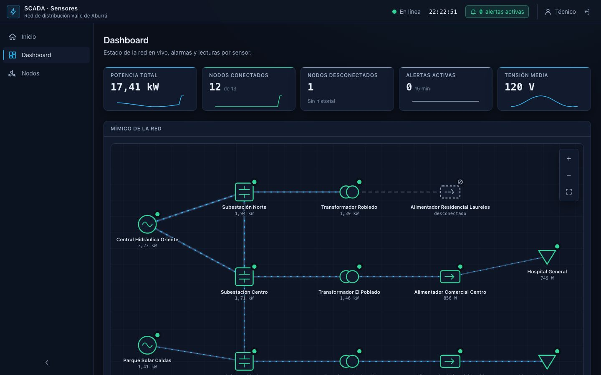
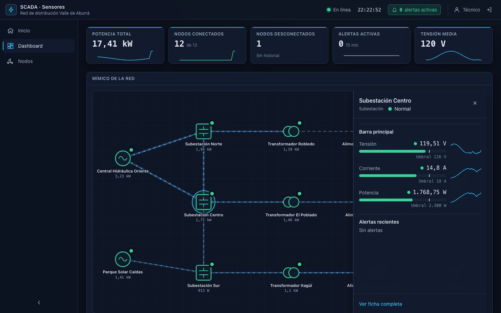
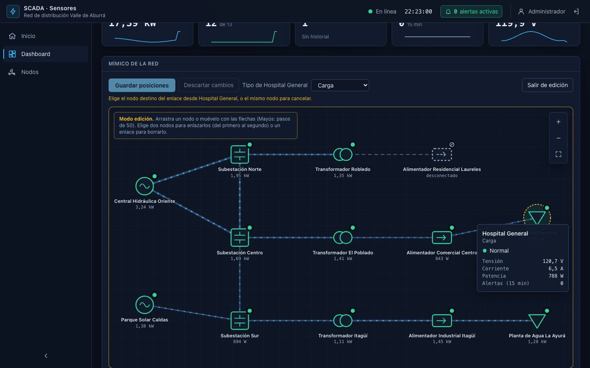
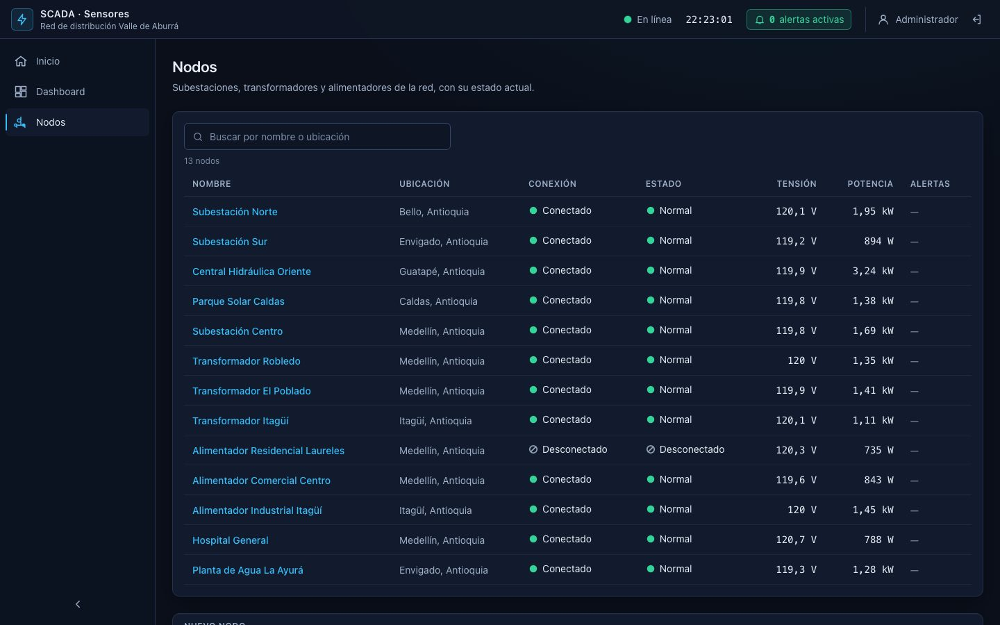
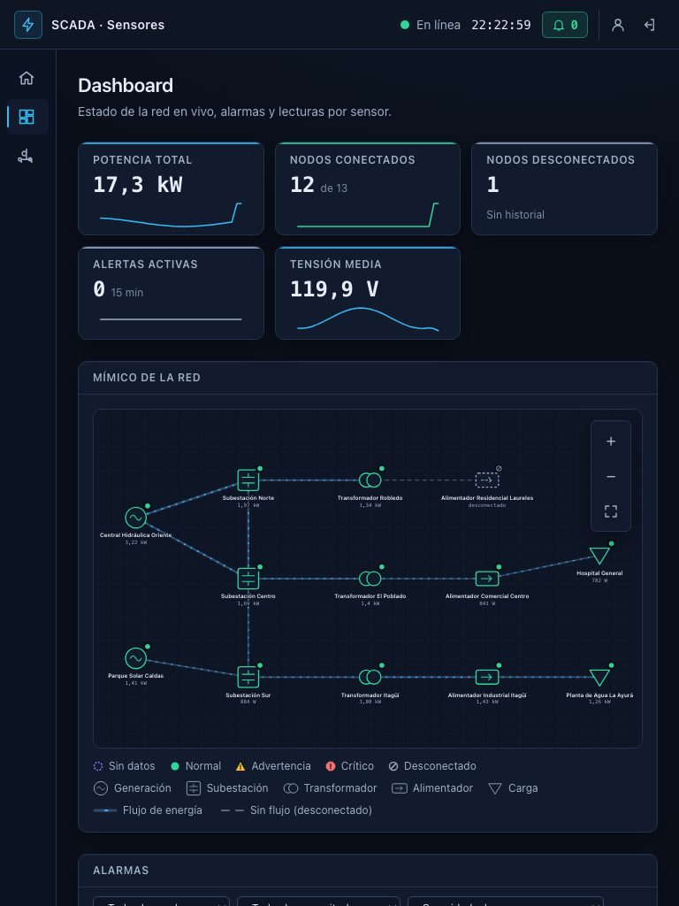

# Tablero de sensores eléctricos (SDD multiagente)

Aplicación para administrar nodos y sensores de una red eléctrica, simular lecturas de voltaje, corriente y potencia, verlas en un tablero y generar alertas por umbral. Se construye con Spec-Driven Development (OpenSpec) y un orquestador de agentes de Claude Code que lleva cada historia de usuario desde el issue hasta el PR, con puertas de calidad y evidencia trazable. Taller "Aplicación de Solución IA bajo SDD", modalidad B; entrega el 24 de noviembre de 2026.

[](https://github.com/CristhianArce/procesos-modernos-software/actions/workflows/ci.yml)

## Stack

- Una sola app **Next.js 16** (App Router) para interfaz y API: páginas con Server Components y componentes `"use client"`, API en **Route Handlers + Zod**.
- **Postgres** con `pg` y SQL escrito a mano; migraciones versionadas con **Flyway**.
- **Docker** (`docker compose` en local) y **GitHub Actions** (lint, pruebas, seguridad, build de la imagen).
- Imagen publicada en **GitHub Container Registry**: `ghcr.io/cristhianarce/procesos-modernos-software`. La app corre desplegada en **Render** (plan gratuito) en https://tablero-oa6d.onrender.com con esa imagen, con su propia base Postgres gratuita (vence a los 30 días): se duerme tras 15 minutos sin uso y la primera petición tarda cerca de 1 minuto. El CD migra y siembra esa base y después avisa a Render al publicar una imagen nueva.
- SDD con **OpenSpec** en lugar de Spec Kit: su numeración secuencial choca cuando varios estudiantes trabajan a la vez y su ciclo no cabe en la demo de 10 minutos (ver [propuesta §4](docs/propuesta.md#4-stack-tecnológico-y-decisiones)).

## Documentación

- [Propuesta de arquitectura y SDD](docs/propuesta.md): requisitos, arquitectura, backlog, reglas del proyecto, cronograma y riesgos.
- [Flujo del orquestador](docs/flujo-orquestador.md): guía de cómo funciona el SDD con IA: los 8 pasos del orquestador (5 minutos o menos), qué corre en el orquestador y qué en el CI, las piezas y dónde queda cada archivo.
- [Rediseño SCADA](docs/ui-scada/plan.md): plan por fases, decisiones y medidas de la interfaz de sala de control.

## Configuración inicial (una vez por portátil)

Requisitos base: Node 24, Git ≥ 2.40 y Docker Desktop. Se usa Git Bash, no PowerShell, para que los comandos coincidan con los permisos de `.claude/settings.json`.

### GitHub CLI (`gh`)

```
winget install --id GitHub.cli --source winget
gh auth login                                  # GitHub.com, HTTPS, autenticar git con gh
gh auth refresh -h github.com -s workflow      # solo si vas a hacer push de .github/workflows/ (HU 2)
gh auth status                                 # verificar
```

El orquestador y el skill `crear-hu` usan `gh` para leer y crear issues y PR. `crear-hu` crea las etiquetas que necesita (`historia`, de fase y `practica`) si faltan; en la secuencia actual el orquestador no etiqueta issues ni PR.

### OpenSpec

```
npm i -g @fission-ai/openspec@2.1              # se fija la serie 2.1.x
openspec --version
openspec validate --all --strict --no-interactive
```

- El repo **ya está inicializado** (`openspec init --tools claude --language es --scope project`, HU 1a). No hay que volver a correr `init`.
- `openspec/config.yaml` trae el idioma, un glosario corto del dominio, las reglas de formato por artefacto (`rules`) y la guía de `apply` y `archive` (`operations`). Las reglas técnicas (stack, capas, datos, seguridad) viven solo en `CLAUDE.md`.
- Los skills `openspec-*` están versionados en `.claude/skills/` y `.agents/skills/`. Si cambia la versión de OpenSpec, se regeneran con `openspec update .`.
- En Claude Code se invocan por nombre: `/openspec-propose`, `/openspec-explore`, `/openspec-apply-change`, `/openspec-update-change`, `/openspec-sync-specs` y `/openspec-archive-change` (desde OpenSpec 2.0 no existen los `/opsx:*`).

### Claude Code

```
npm i -g @anthropic-ai/claude-code             # o el instalador oficial de https://claude.com/claude-code
claude                                         # en la raíz del repo; la primera vez pide iniciar sesión (/login)
node --test ".claude/tests/*.test.mjs"         # pruebas de la configuración de IA
```

Qué trae el repo y no hay que configurar a mano:

- `CLAUDE.md`: reglas del proyecto (stack, capas, datos, seguridad, SDD y reglas de agentes).
- `.claude/settings.json`: permisos compartidos. La lista `allow` cubre los comandos del flujo y la lista `deny` bloquea merge, aprobar PR, force push, amend, rebase, reset y leer `.env`. Los ajustes personales van en `.claude/settings.local.json` (ignorado por git), nunca en el compartido.
- `.claude/skills/`: `orquestador`, `build-test`, `commit`, `abrir-pr`, `crear-hu` (redacta y publica historias como issues), `archivar-change-openspec` (después de mezclar un PR: archiva el change y actualiza los specs) y los skills de OpenSpec. `.claude/agents/`: `preparador`, `revisor-salida` (G2), `escritor-pruebas`, `revisor-reglas` y `trazabilidad` (pospuesto).
- `.flujo/` (`<trabajo>` de cada issue) está fuera de git.

Para cualquier cambio, actualiza `main` y crea una rama: `git switch main`, `git pull` y `git switch -c <rama>`. El flujo no usa worktrees.

## Cómo ejecutar (cuando la HU 1 y la HU 2 estén fusionadas)

Requisitos: los de la [configuración inicial](#configuración-inicial-una-vez-por-portátil).

```
cp .env.example .env                          # completar los valores locales (POSTGRES_*, SESSION_SECRET, METRICS_TOKEN)
docker compose up -d --wait db                # Postgres
docker compose run --rm flyway migrate info   # aplicar migraciones
npm ci
DATABASE_URL="postgres://<POSTGRES_USER>:<POSTGRES_PASSWORD>@localhost:$(docker compose port db 5432 | sed 's/.*://')/<POSTGRES_DB>" npm run seed   # datos semilla
docker compose up -d --build --wait app       # la app, sana según /api/health
docker compose port app 3000                  # puerto local asignado
```

Los puertos del host son efímeros (así varias historias corren a la vez), por eso el seed toma el puerto de la BD de `docker compose port`. Para apagar todo y borrar los datos: `docker compose down -v`.

O, sin compilar, con la imagen publicada:

```
docker pull ghcr.io/cristhianarce/procesos-modernos-software:latest
```

### Cuentas de demostración

`npm run seed` carga dos cuentas (la semilla `db/seed/auth.sql` guarda solo el hash). Son de demostración y no protegen datos reales:

| Usuario | Rol | Contraseña |
|---|---|---|
| `admin` | administrador | `Demo-Admin-2026` |
| `tecnico` | técnico | `Demo-Tecnico-2026` |

Se inicia sesión en `/login`. Tras 5 intentos fallidos en un minuto, la API responde 429 y hay que esperar.

## Sala de control (rediseño SCADA)

La interfaz es una sala de control de tema oscuro. Muestra un **mímico** (diagrama unifilar) de la red, con flujo de energía animado, indicadores, panel de alarmas y datos en vivo. Está hecha sin librerías nuevas, con SVG y CSS propios. La semilla `db/seed/topologia.sql` trae una red de 13 nodos.



| Panel lateral del nodo | Editor del administrador |
|---|---|
|  |  |
| **Nodos** | **Tableta (768 px)** |
|  |  |

Más capturas en [docs/ui-scada/capturas](docs/ui-scada/capturas): login, dashboard a 1024 px y página completa.

**Datos en vivo.** El navegador consulta `GET /api/estado` cada 2,5 s. El sondeo se pausa con la pestaña oculta y, si falla, la barra superior dice «Sin conexión». Para que las lecturas se muevan solas, enciende el simulador continuo con `SIM_AUTO_MS` (milisegundos entre pasos, mínimo 500; sin la variable queda apagado):

```
SIM_AUTO_MS=2500 npm run dev        # o: npm run build && SIM_AUTO_MS=2500 npm start
```

El simulador genera lecturas con deriva suave y picos ocasionales, omite los nodos desconectados, registra las alertas por el mismo camino que el botón Simular y poda las lecturas de más de una hora. El `docker-compose.yml` no pasa `SIM_AUTO_MS` a la app, así que en Docker queda apagado.

**Uso.**
- Clic o Enter en un nodo abre su panel lateral (medidores frente a los umbrales, minigráficas y alertas); Esc lo cierra.
- La rueda acerca o aleja, el fondo se arrastra y el botón de encuadre muestra toda la red.
- El administrador tiene «Editar topología»: arrastra nodos o los mueve con las flechas, elige dos nodos para enlazarlos, elige un enlace para borrarlo y guarda las posiciones. El técnico no ve el editor y la API le responde 403.
- Con `prefers-reduced-motion` no hay animaciones de flujo ni parpadeos.

**Pruebas e2e del rediseño:** `e2e/mimico.spec.ts` y `e2e/topologia.spec.ts`, contra la app levantada con la semilla (`BASE_URL=http://localhost:<puerto> npm run e2e`).

## Implementar un issue con el orquestador

Cada historia de usuario es un issue de GitHub con criterios de aceptación numerados (`CA-n`). El orquestador (`/orquestador <n>`) la lleva en 8 pasos, y en 5 minutos o menos, desde el issue hasta un PR en borrador con su change de OpenSpec y sus evidencias. El detalle de cada paso está en el [flujo del orquestador](docs/flujo-orquestador.md). Se usa desde la HU 3: las HU 1a, 1b y 2 se construyen en modo interactivo.

> **Todavía no se puede correr de punta a punta:** necesita `package.json`, `.env` y el `docker compose` que traen la HU 1b (#2) y la HU 2. Sin ellos se detiene en la precondición sin crear nada.

### 1. Antes de empezar

- La [configuración inicial](#configuración-inicial-una-vez-por-portátil) hecha (`gh auth status` en verde, OpenSpec 2.1 y Claude Code).
- El issue existe, abierto, sin PR y con sus `CA-n` (las historias del backlog llevan la etiqueta `historia`). Para redactarlo y publicarlo, en Claude Code: `/crear-hu <descripción o fila del backlog>`.
- El checkout principal está en `main`, actualizado y **limpio** (`git switch main`, `git pull`, `git status` sin cambios; `.flujo/` se ignora). El orquestador crea la rama de la historia en este checkout, así que corre **una sola sesión de Claude en ese clon** mientras dura; si necesitas otra, usa otro clon.
- Docker está en marcha, `.env` existe y las dependencias están instaladas (la BD la levanta, migra y siembra `build-test`, así que de estos comandos solo `npm ci` es obligatorio; los de Docker sirven para comprobarla a mano):

  ```
  docker compose up -d --wait db
  docker compose run --rm flyway migrate info
  npm ci
  ```

### 2. Correrlo

```
claude                     # en la raíz del repo
/orquestador <n>           # por ejemplo /orquestador 6
```

Se escribe a mano: Claude no lo invoca por su cuenta. Durante la corrida:

- Te pregunta las dudas de negocio (las preguntas abiertas del issue y las que surjan al proponer). Tus respuestas quedan en `decisiones.md` con `Decidió: Persona`.
- Claude Code puede pedirte aprobar algún comando que no esté en `.claude/settings.json`.
- Si una puerta o el build fallan, corrige una sola vez. Si sigue fallando, se detiene en **Bloqueado**. También se detiene si al implementar queda una tarea `[ ]` sin su motivo en `decisiones.md`.

### 3. Qué deja

| Dónde | Qué |
|---|---|
| Rama `feature/issue-<n>-<slug>` | El código, las pruebas (cada una nombrada `#<n> CA-k: ...`), la migración y la semilla si aplican |
| `openspec/changes/<change>/` | proposal, specs, design y tasks, cada uno citando su `CA-n` |
| PR en borrador | `Closes #<n>`, `Change: <change>`, la tabla de `CA` con la prueba de cada uno (o "Sin prueba") y las tareas que quedaron pendientes con su motivo |
| `evidencias/issue-<n>/` | issue, contexto, decisiones, G2 (`gates.md`), trazabilidad CA → requisito/escenario → tarea → prueba, verificación y agentes |
| `.flujo/issue-<n>/` | El `<trabajo>` completo de la corrida (fuera de git) |

Al final muestra en el chat el tiempo por paso, la URL del PR, los veredictos y las decisiones.

El tiempo de la corrida queda medido en `.flujo/issue-<n>/tiempos.md` (y en `evidencias/issue-<n>/tiempos.md`): duración por paso y total contra la meta de 5 minutos.

Para probar el orquestador antes de la HU 1b y la HU 2 hay historias de **práctica** (etiqueta `practica`): corren sin BD ni Docker, instalan sus dependencias durante la implementación y su PR no se fusiona. Para repetir una, cierra el PR y borra la rama (local y remota) y `.flujo/issue-<n>/`.

### 4. Si se bloquea o se corta

- El motivo queda en `.flujo/issue-<n>/bloqueo.md` y en `estado.md`. No comenta ni etiqueta el issue: eso lo decides tú.
- Corrige la causa (por ejemplo, levanta la BD) y retoma sin repetir lo hecho: `/orquestador <n> desde=propuesta|implementar|verificar|pr`.

### 5. Después del PR (a mano)

1. Revisa el PR y márcalo listo (`gh pr ready <pr>`).
2. Lo revisa y aprueba **otra cuenta**: el autor no puede aprobar su propio PR, y ni el orquestador ni los agentes hacen merge.
3. Tras el merge, archiva el change en un PR propio, uno a la vez. Antes comprueba que no queden tareas (`openspec instructions apply --change <change> --json` con `progress.remaining == 0`), porque `openspec archive <change> --yes` archiva aunque las haya. Los comandos están en el [paso 10 del flujo](docs/flujo-orquestador.md).

Para practicar está el issue #6 "[PRUEBA] Página Acerca de" (etiqueta `prueba`); su PR se cierra sin fusionar.

## Evidencias

- `evidencias/issue-<n>/`: contexto, decisiones, puerta de calidad G2 (`gates.md`), trazabilidad CA → requisito/escenario → tarea → prueba (`trazabilidad.md`), verificación y agentes que intervinieron en cada historia.
- `AGENTS_LOG.md`: índice de todas las historias con sus rechazos y correcciones; se regenera al archivar cada change.
